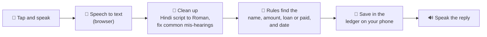

<div align="center">

# 🎙️ Voice Khata

### *Bolo, aur khata likh jaayega.*
**Speak, and your ledger writes itself.**

From Paper Khata to a Voice-Powered Digital Ledger, built for small shopkeepers.

[](https://kernel-ux.github.io/voice/)


**[👉 Try it live: kernel-ux.github.io/voice](https://kernel-ux.github.io/voice/)**

</div>

---

## 📸 Screenshots

<div align="center">

| Dashboard | Customers | Recent entries |
|:---:|:---:|:---:|
|  |  |  |

</div>

---

## 💡 The problem

A shopkeeper in the middle of a sale can't stop to write or type. So *udhaar* (credit) gets noted late, noted wrong, or never noted at all. Owners lose money on forgotten udhaar, and customers get blamed for amounts they don't owe.

| Today's options | Why they fail |
|---|---|
| 📓 Paper notebook | Slow at the counter. Easy to lose, hard to total. |
| 📱 Khata apps | Need typing, so you need both hands and eyes. |
| 🤖 Generic voice assistants | Struggle with Hinglish, Indian names and noisy shops. |

## ✨ The solution

**Voice Khata** lets you just say what happened. One tap, one sentence, and the entry is saved. It speaks the answer back to you, so your hands and eyes stay on the customer.

> 🗣️ *"Ramesh ka 340 udhaar, kal 200 diya tha"*
> ✅ Ramesh: ₹340 udhaar (today) and ₹200 jama (yesterday). Entries saved.

---

## 🚀 Features

| | Feature | What it means |
|---|---|---|
| 🎤 | **Speak in Hindi, Hinglish or English** | Switch language with one tap. Voice, replies and the whole screen change together. |
| 🧾 | **Two entries in one sentence** | "Ramesh took 500, Suresh paid 200" becomes two separate entries. |
| 🔢 | **Understands how people really say numbers** | "dhai sau" = 250, "two fifty" = 250, "2k" = 2000, "five hundred" = 500. |
| 📅 | **Understands dates** | "kal", "parso", "yesterday", "2 days ago", "on Monday". |
| ✏️ | **Spoken corrections** | Say *"No, 430"* and the last entry is fixed, not duplicated. |
| 🤔 | **Asks when unsure** | Two Rameshes? It asks *"Which Ramesh?"* and remembers your answer. |
| 🆕 | **Adds new customers by itself** | Say a new name and it creates the customer for you. |
| 🔊 | **Speaks back** | Balances and confirmations are read out loud, in the language you picked. |
| ⚡ | **Fast** | Answers appear in milliseconds because the logic runs on your phone. |
| 🔒 | **Private** | Your ledger is saved only on your device. No sign-up, no server. |

---

## 🗣️ What can I say?

### English

| You say | What happens |
|---|---|
| `Ramesh took a loan of 340` | Adds a ₹340 **loan** for Ramesh |
| `Ramesh paid me back 200` | Adds a ₹200 **payment** for Ramesh |
| `Suresh owes two fifty` | Adds a ₹250 loan for Suresh |
| `he took 500 yesterday` | Adds ₹500 to the last customer you mentioned, dated yesterday |
| `No, 430` | Fixes the last entry to ₹430 |
| `Ramesh total?` | Speaks Ramesh's balance |
| `How much does Suresh owe` | Speaks Suresh's balance |
| `Remove last entry` | Undoes the last entry |

### हिन्दी / Hinglish

| You say | What happens |
|---|---|
| `Ramesh ka 340 udhaar` | Adds ₹340 **udhaar** for Ramesh |
| `Suresh ka dhai sau jama` | Adds ₹250 **jama** for Suresh |
| `Ramesh ka 340 udhaar, kal 200 diya tha` | Adds two entries, one of them dated yesterday |
| `nahi, 430` | Fixes the last entry to ₹430 |
| `Ramesh ka total?` | Speaks Ramesh's balance |
| `Pichli entry hatao` | Undoes the last entry |

> 💡 **Tip:** Hold the phone close and say the **name first**. You can also type any of these sentences in the box at the bottom.

---

## ⚙️ How it works



1. **Tap the mic and speak.** The browser's speech recognition turns your voice into text.
2. **The text is cleaned up.** Hindi script becomes Roman letters, and words like "dhai sau" or "two fifty" become numbers.
3. **Simple rules, no AI call.** The name, amount, loan or payment, and a date like "yesterday" are picked out by plain code. That is why it is fast and works for free.
4. **Names are matched.** Similar-sounding names match, and words like *bhai* or *ji* are ignored. If two customers have a similar name, it asks you.
5. **Saved and spoken.** The entry is saved on your phone, the balance is worked out in code, and the answer is read back to you.

---

## 🧰 Tech stack

| Part | What we used |
|---|---|
| **App** | A single `index.html` file with plain HTML, CSS and JavaScript. No frameworks, no build step. |
| **Voice in** | Web Speech API: `SpeechRecognition` (`hi-IN` and `en-IN`) |
| **Voice out** | Web Speech API: `SpeechSynthesis` (picks an Indian English voice when available) |
| **Understanding** | Hand-written rules: number words, dates, loan/paid words, fuzzy name matching |
| **Storage** | Browser `localStorage` (your data never leaves the device) |
| **Hosting** | GitHub Pages |

---

## ▶️ Run it yourself

**Option 1: Just open the live app**
👉 [kernel-ux.github.io/voice](https://kernel-ux.github.io/voice/)

**Option 2: Run it locally**

```bash
# 1. Get the code
git clone https://github.com/kernel-ux/voice.git
cd voice

# 2. Start a tiny local server (any one of these)
python3 -m http.server 8000
# or
npx serve
```

Then open **http://localhost:8000** in **Google Chrome**.

> The mic needs `https://` or `localhost`, so opening the file by double-clicking may not work. GitHub Pages already uses `https://`.

### ✅ Browser support

| Browser | Voice input | Voice output |
|---|:---:|:---:|
| Chrome on Android | ✅ | ✅ |
| Chrome on desktop | ✅ | ✅ |
| Safari / Firefox | ⚠️ Limited | ✅ |

If the mic is blocked, open the page directly in a Chrome tab (not inside another app) and tap **Allow**. You can always type your sentence instead.

---

## 🔒 Privacy

- Your customers and entries are stored **only on your device**.
- There is **no account, no server and no database** behind this app.
- Voice is turned into text by your browser's own speech service (in Chrome this is provided by Google), so use it the way you would use voice typing.
- Settings (⋮) → **Clear all data** removes everything.

---

## 🗺️ What's next

Ideas we plan to build on top of this prototype:

- [ ] Smarter noise handling with voice activity detection
- [ ] Indian-language speech models tuned for shop names and Hinglish
- [ ] An AI fallback for very messy sentences, with rules still handling the common cases
- [ ] Offline mode and install as an app (PWA)
- [ ] Cloud backup and sync across phones
- [ ] More Indian languages

---

## 👥 Team

| | |
|---|---|
| **Team name** | team π |
| **Team ID** | team-B749B01B982F |
| **Theme** | From Paper Khata to Voice-Powered Digital Ledger |

---

<div align="center">

**A khata that keeps up with the counter.** 🧾

If you like this project, give it a ⭐

</div>
